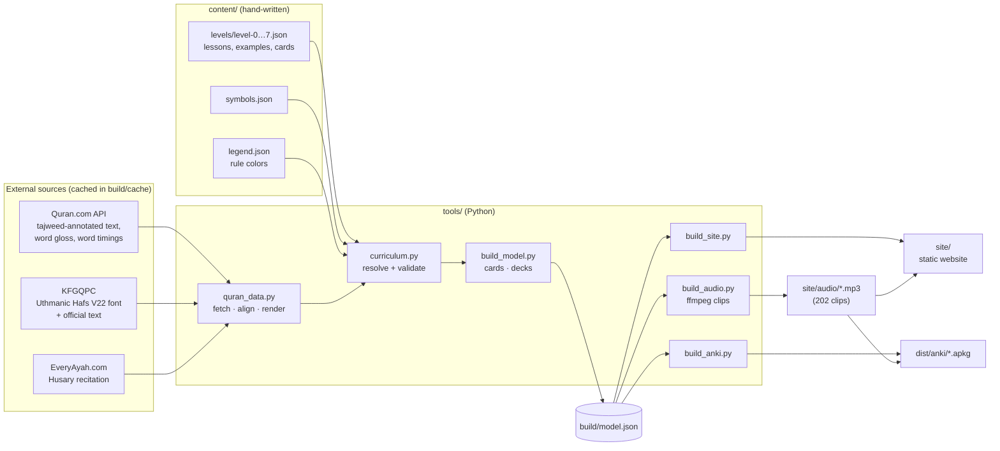
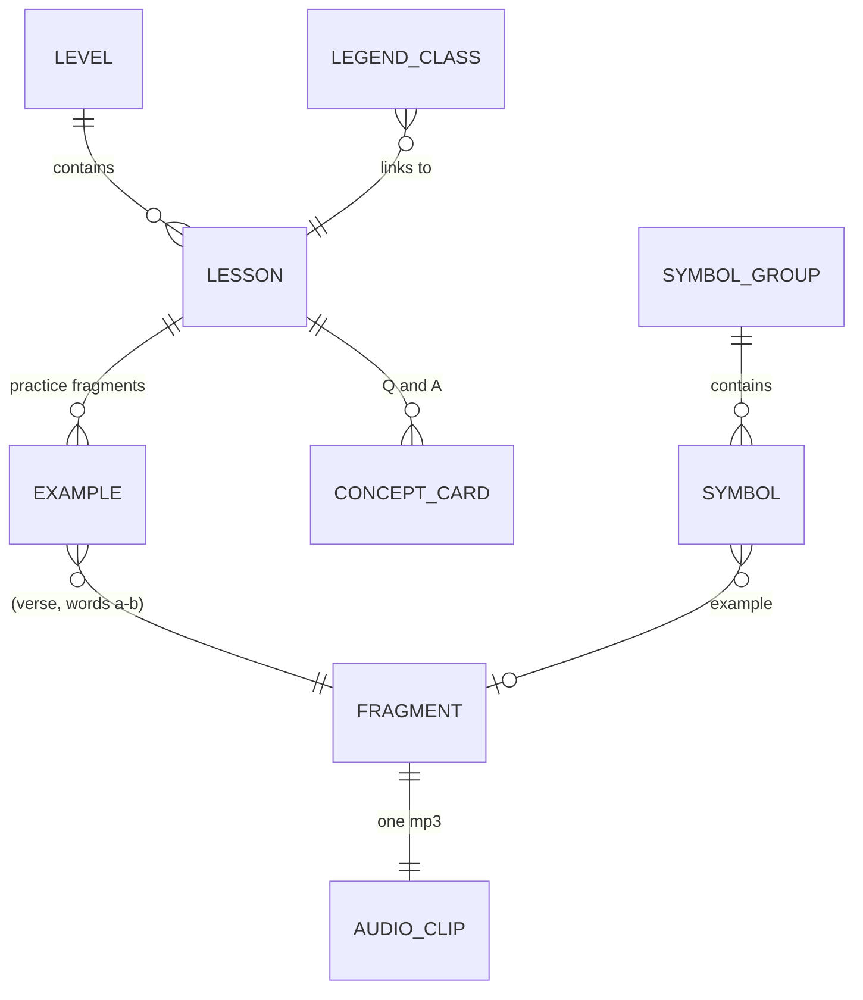
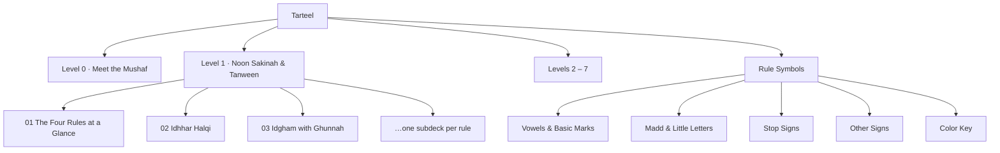
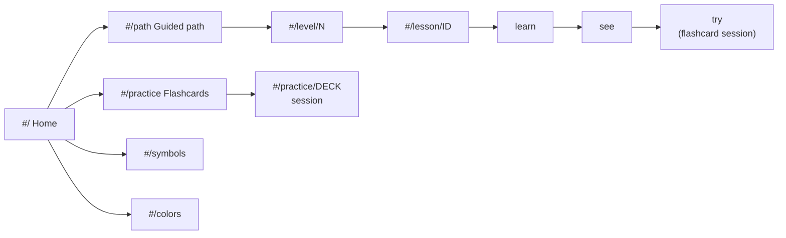

# Architecture

Tarteel ships **two deliverables from one source of truth**: a static website and a set of Anki decks. Both are generated from the same content files, so a lesson, a card or a color can never drift between them.



## Why this shape

| Decision | Reason |
|---|---|
| **One model, two renderers** | The curriculum is authored once. `build_model.py` turns it into cards and decks; the site and Anki builders only *render*. |
| **Examples are references, not copied text** | A content author writes `{"ref": "68:19", "at": "من ربك"}`. The pipeline finds the words in the real verse, so there are no typos in the Quran text and word numbers are never counted by hand. |
| **Every example is validated** | A lesson can declare `expect` (a tajweed color that must appear) or `check` (a text test such as "noon sakinah before a throat letter"). A wrong example **fails the build**. While authoring this course the validator caught several bad picks. |
| **Static site, no framework** | No server, no build step for the front end, works from `file://` and GitHub Pages. Course data ships as a `<script>` (`data/content.js`), not a `fetch`, so opening `index.html` directly works. |
| **Progress lives in the browser** | `localStorage` only. No accounts, no tracking. The site also works with storage disabled. |
| **Audio cut per fragment** | Each card plays exactly its words, not the whole verse. Clips are cut with ffmpeg using per-word timings and are shared by the site and Anki. |

## The Quran text and font

The learner always sees **KFGQPC's own text rendered in KFGQPC's own font** (Uthmanic Hafs V22), the typeface of the Madinah Mushaf.

The tajweed annotation comes from Quran.com, which uses slightly different code points (for example U+0672 for a small alif, which the font draws as a placeholder; stacked rather than open tanween; a different sukun). `quran_data.align_markup()` therefore aligns the two texts character by character and carries each letter's tajweed class onto the KFGQPC text. Quran.com's encoding is still used internally to *match* examples and *validate* rules.

Other source-data issues handled in `quran_data.py`:

- Quran.com sometimes **nests** tags (a silent alif inside an obligatory-madd span) and **one verse (32:3) has a broken tag**. A stack parser and an explicit fix handle both.
- Cross-word rules (idgham, ikhfa, iqlab) are tagged as one span that *includes the space*. Words are split per character and the tag is re-opened on each side.
- The hizb/sajdah signs ۞ ۩ are not words in the audio timings, so they are attached to the neighboring word to keep word numbers aligned.
- Quran.com colors a madd only where the Mushaf prints a madd sign. Unmarked natural madd (the alif of قَالَ) is colored by a small, conservative supplementary pass, so that natural madd is colored consistently.

## Content model



A **lesson** (a rule) has: title, Arabic name, literal meaning, summary, explanation, letters, length in counts, how-to steps, how to spot it, tips, common slips, and examples.

Cards are generated from a lesson:

| Card | Front | Back |
|---|---|---|
| **Recite** | A colored fragment with its surah and verse label | Audio, gloss, rule chips, note |
| **Identify** | The same fragment *uncolored*, target letters highlighted, plus the question | The colored text, the rule name and a summary |
| **Concept** | A question about the rule | The answer |
| **Symbol** | A Mushaf sign | Name, meaning, what to do, an example with audio (plus a reverse card in Anki) |
| **Color key** | A color swatch | The rule it stands for (plus a reverse card in Anki) |

`Identify` cards are only created for families of lessons that share a question (for example the four noon-sakinah rules, or the seven madd types), so the answer always has real alternatives.

## Curriculum (Levels 0 to 7)

| Level | Theme | Lessons |
|---|---|---|
| 0 | Meet the Mushaf | Colors, short vowels, sukun, shaddah, tanween, long vowels, little letters |
| 1 | Noon Sakinah & Tanween | Overview, idhhar, idgham (with / without ghunnah), iqlab, ikhfa, ghunnah |
| 2 | Meem Sakinah | Overview, ikhfa shafawi, idgham shafawi, idhhar shafawi |
| 3 | Madd | Overview, natural, connected, separated, on stopping, leen, badal, necessary, silah |
| 4 | Letter rules | Qalqalah, sun and moon lam, hamzat al-wasl, silent letters, merging two letters |
| 5 | Heavy, light, articulation | Heavy letters, ra, lam of Allah, makharij |
| 6 | Stopping and starting | How to stop, stop signs, how to start |
| 7 | Read whole surahs | 12 short surahs, verse by verse |

## Anki deck tree



Packages: `Tarteel-Complete.apkg` (everything), one package per level, and `Tarteel-Rule-Symbols.apkg`. Notes have stable GUIDs and decks have stable ids derived from their names, so re-importing a newer build updates cards in place and the per-level packages merge into the same tree.

## Website routes



**Two ways to learn**

- **Guided path** (progressive): each lesson is *meet the rule → see examples → try it*. Finishing the practice marks the lesson done, and the path map shows "you are here".
- **Flashcards** (repetitive): jump straight into any deck. A simplified SM-2 spaced-repetition scheduler (Again / Hard / Good / Easy) brings hard cards back sooner. Options: choose card types, smart review or free shuffle, autoplay on flip.

## Folder layout

```
tarteel/
├─ content/              hand-written curriculum (the only thing you normally edit)
│  ├─ levels/level-N.json
│  ├─ symbols.json
│  └─ legend.json
├─ tools/                the build pipeline (Python)
│  ├─ build.py           run everything
│  ├─ quran_data.py      fetch, align, render Quran text
│  ├─ curriculum.py      resolve + validate content
│  ├─ build_model.py     cards and decks
│  ├─ build_audio.py     ffmpeg clip cutting
│  ├─ build_site.py      data.js + color css
│  ├─ build_anki.py      .apkg packages
│  └─ preview_anki.py    dev: render Anki templates as HTML
├─ site/                 the deployable static website
│  ├─ index.html, css/, js/app.js, fonts/, audio/, data/, downloads/
├─ dist/anki/            the Anki packages
├─ docs/                 this document and the content guide
└─ build/                downloaded source data (git-ignored)
```

## Accessibility and robustness

- Light and dark themes (follows the system, with a manual toggle), respects `prefers-reduced-motion`.
- Keyboard flow in flashcards (Space, 1–4, P); visible focus; semantic buttons and links; progress bars have ARIA values.
- Every rule color has a name, so color is never the only signal, and "identify" cards deliberately remove color.
- Works with `localStorage` blocked (progress simply isn't saved).
